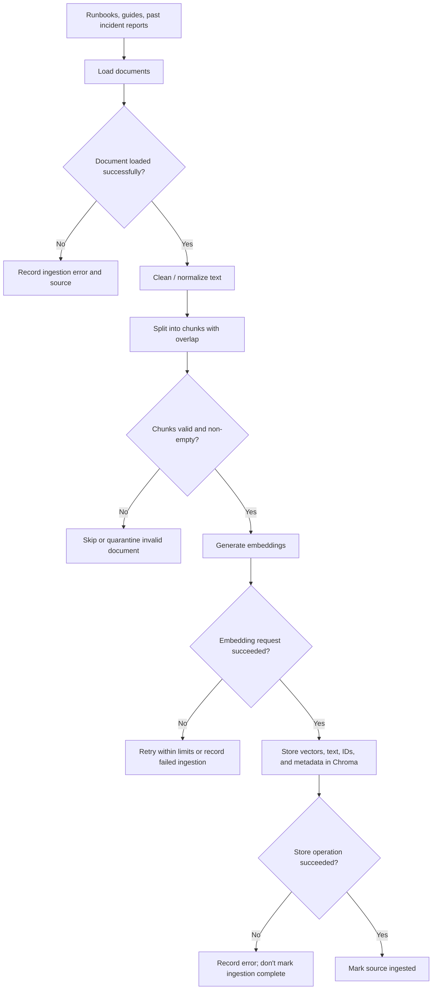
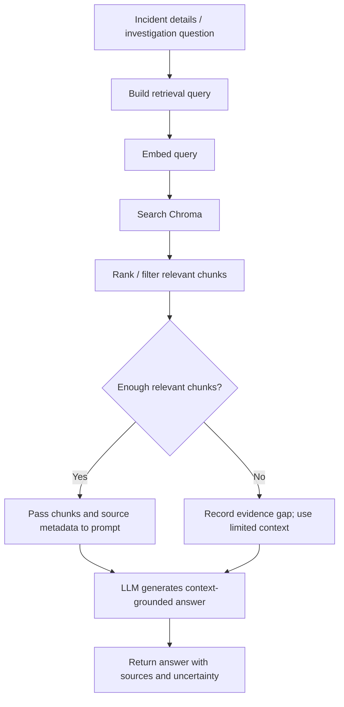
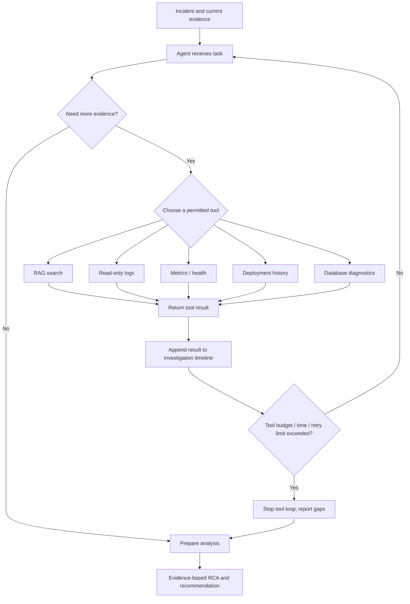

# OpsPilot — Complete Architecture & Flow Notes

## 1. Project goal

OpsPilot is an AI-assisted incident investigation and resolution platform for software engineering and DevOps teams. It should help engineers receive incidents, classify them, search runbooks and past incidents, gather operational evidence, identify a likely root cause, recommend a fix, gate risky actions behind human approval, verify the outcome, and record a final report.

**Safety principle:** an LLM classification or explanation is a hypothesis, not proof. Ground conclusions in documents and tool evidence. Never run a high-impact production action just because the model suggested it.

## 2. Current progress

### Implemented / tested
- FastAPI application and health endpoint.
- Incident API request path and Pydantic input model.
- Gemini chat model configuration.
- `ChatPromptTemplate` for incident classification.
- `with_structured_output(IncidentClassification)`.
- LCEL chain: `prompt | structured_llm`.
- Invoking the chain and receiving a Pydantic classification object.
- Returning classification in the incident response (ensure the response schema declares all returned fields).

### Planned next
1. RAG knowledge ingestion and retrieval.
2. RAG chain connected to investigation.
3. Read-only diagnostic tools.
4. Agent/tool calling to select tools dynamically.
5. Investigation timeline, persistence, and memory.
6. Human approval and controlled remediation.
7. Verification and final reporting.
8. Production hardening; consider LangGraph later for explicit stateful workflows.

## 3. Complete end-to-end target flow

This is the intended target architecture. Several branches are future work, not implemented features yet.

```mermaid
flowchart TD
    A[Engineer or monitoring system] --> B[POST /incidents]
    B --> C{Request valid?}
    C -- No --> C1[Return validation error]
    C -- Yes --> D[Incident service]
    D --> E[Create incident ID and initial status]
    E --> F[Persist incident in PostgreSQL]
    F --> G[LLM classification chain]
    G --> H{Classification succeeded?}
    H -- No --> H1[Record classification failure; keep incident open]
    H -- Yes --> J[Validate structured classification]
    J --> K[Save category, severity, summary, impact]
    K --> I[Return incident and current status]
    H1 --> I
    I --> L{Investigation requested?}
    L -- No --> L1[Wait for explicit investigation request]
    L -- Yes --> M[Create investigation record and timeline]
    M --> N[Retrieve relevant knowledge with RAG]
    N --> O{Relevant knowledge found?}
    O -- Yes --> P[Keep chunks and source metadata]
    O -- No --> Q[Record knowledge gap; do not invent sources]
    P --> R[Run diagnostic investigation]
    Q --> R
    R --> S[Agent / investigation orchestrator]
    S --> T{What evidence is needed?}
    T --> U[RAG / runbook search]
    T --> V[Read-only logs tool]
    T --> W[Metrics and service-health tools]
    T --> X[Recent-deployments tool]
    T --> Y[Database-health tools]
    U --> Z[Collect tool results and errors]
    V --> Z
    W --> Z
    X --> Z
    Y --> Z
    Z --> AA{Tool failed or returned no data?}
    AA -- Yes --> AB[Record limitation; retry safely or use other evidence]
    AA -- No --> AC[Combine available evidence]
    AB --> AC
    AC --> AD{Enough reliable evidence?}
    AD -- No --> AE[Ask for more information or report uncertainty]
    AE --> AF[No automatic risky action]
    AD -- Yes --> AG[LLM synthesizes likely root cause]
    AG --> AH[Generate evidence-linked RCA and recommendations]
    AH --> AI{Recommendation informational only?}
    AI -- Yes --> AJ[Return recommendation and evidence]
    AI -- No --> AK[Check policy, permissions, and risk]
    AK --> AL{Action allowed and approval required?}
    AL -- Blocked --> AM[Reject action; explain why]
    AL -- Approval needed --> AN[Create approval request]
    AN --> AO{Human approves?}
    AO -- No --> AP[Record rejection; do not execute]
    AO -- Yes --> AQ[Re-check authorization and preconditions]
    AL -- No approval required by policy --> AQ
    AQ --> AR{Preconditions still valid?}
    AR -- No --> AS[Stop; refresh evidence or request review]
    AR -- Yes --> AT[Execute allow-listed remediation tool]
    AT --> AU{Execution succeeded?}
    AU -- No --> AV[Record failure; do not claim resolved]
    AU -- Yes --> AW[Verify service health, error rate, and relevant metrics]
    AW --> AX{Incident resolved according to checks?}
    AX -- Yes --> AY[Mark resolved]
    AX -- No --> AZ[Keep open; continue investigation or request human help]
    AZ --> S
    AJ --> BA[Build final incident report]
    AM --> BA
    AP --> BA
    AS --> BA
    AV --> BA
    AY --> BA
    AF --> BA
    BA --> BB[Persist report, evidence, timeline, and status]
    BB --> BC[GET incident details, timeline, and report]
```

### Read the flow in five sections
1. **Intake:** validate the request, create and persist the incident, then attempt classification.
2. **Knowledge retrieval:** RAG searches runbooks and past incidents. If nothing relevant is found, record the gap instead of pretending.
3. **Evidence gathering:** the orchestrator/agent selects permitted diagnostic tools. Tool failures and empty results are recorded.
4. **Decision and remediation:** generate a likely cause and recommendation. Policy and human approval protect production actions.
5. **Verification and reporting:** after an action, check whether the incident is actually resolved; persist the evidence, timeline, status, and report.

## 4. RAG ingestion flow — prepare knowledge before incidents arrive

### RAG query-time flow

Ingestion runs when documents are added or updated. Retrieval runs when an incident needs knowledge. Similarity scores are not proof of correctness; test retrieval quality and acknowledge missing evidence.

## 5. Agent and tools: decision logic

An agent is useful when the next step is not fully predetermined. It may choose a runbook search, log inspection, or deployment check based on the incident.

**Tool guardrails**
- Start with read-only tools.
- Give each tool a clear input schema, permission boundary, timeout, and error behavior.
- Limit calls, retries, and total investigation time.
- Treat logs and retrieved documents as data, not instructions that override system policy.
- A model-generated tool argument must not itself authorize a production action.
- Audit tool name, input, result, timestamp, and outcome; redact secrets.

## 6. Remediation and approval conditions

| Condition | Expected behavior |
|---|---|
| Recommendation only; no action requested | Return recommendation and supporting evidence. |
| Action is not allow-listed | Block it and explain why. |
| Caller lacks permission | Block it and record the authorization failure. |
| Policy requires approval | Create an approval request; do not execute yet. |
| Human rejects | Record rejection; do not execute. |
| Approval expires or incident state changes | Do not execute; request fresh review. |
| Human approves and preconditions still hold | Execute only the approved action. |
| Preconditions no longer hold | Stop and re-check the situation. |
| Execution fails | Record failure; do not mark incident resolved. |
| Execution succeeds | Run independent verification checks. |
| Verification passes | Mark resolved and record evidence. |
| Verification fails | Keep incident open; investigate further or escalate. |

Approval should be tied to a specific action, incident, target, and parameters. Re-check authorization and preconditions immediately before execution.

## 7. Where each technology fits

| Component | Responsibility | Stage |
|---|---|---|
| FastAPI | API endpoints and request/response validation | Already in use; add investigation/report endpoints later |
| Pydantic | Validate input and structured output | Already in use |
| Incident service | Business logic and coordination | Already in use; extend gradually |
| Gemini / LLM | Classification, synthesis, recommendations | Classification implemented |
| ChatPromptTemplate | Defines messages and instructions | Implemented for classifier |
| LCEL | Composes predictable pipeline steps | Implemented for classification; next for RAG |
| LangChain document loaders | Load runbooks and reports | RAG phase |
| Text splitter | Create manageable chunks | RAG phase |
| Embedding model | Convert chunks and queries into vectors | RAG phase |
| Chroma | Store and retrieve vectorized chunks | RAG phase |
| Retriever | Return relevant documents for a query | RAG phase |
| Tools | Controlled access to logs, metrics, deployments, databases | After RAG foundation |
| Agent / tool calling | Choose tools dynamically when needed | After read-only tools are tested |
| PostgreSQL | Durable incidents, investigations, approvals, reports, audit records | Add persistence incrementally |
| Redis | Optional cache or short-lived state | Add only for a clear need |
| Human approval | Gate risky changes | Before enabling remediation |
| Verification logic | Check whether incident is actually resolved | After controlled remediation |
| LangGraph | Explicit stateful, branching, resumable workflow orchestration | Later, if complexity warrants it |
| Background worker / queue | Run long investigations without blocking API requests | Once synchronous flow works |

## 8. Suggested API surface

These are target endpoints; not all are implemented yet.

| Endpoint | Purpose |
|---|---|
| `GET /health` | Check application health |
| `POST /incidents` | Validate and create an incident; classify it |
| `GET /incidents/{id}` | Get incident details and status |
| `POST /incidents/{id}/investigate` | Start an investigation |
| `GET /incidents/{id}/timeline` | View steps, evidence, and tool outcomes |
| `GET /incidents/{id}/report` | Get the latest RCA / final report |
| `POST /incidents/{id}/approve` | Approve a specific proposed action |
| `POST /incidents/{id}/reject` | Reject a specific proposed action |
| `POST /knowledge/documents` | Add a document to the ingestion pipeline |

## 9. Build and learning roadmap

### Phase 1 — Incident intake and classification
- [x] FastAPI health endpoint
- [x] Incident request model
- [x] Gemini configured
- [x] Prompt template
- [x] Structured Pydantic output
- [x] LCEL chain invoked successfully
- [x] Connect classification to API and ensure response schema includes classification

### Phase 2 — RAG
- [ ] Create sample runbooks and incident reports
- [ ] Load documents
- [ ] Chunk and preserve metadata
- [ ] Generate embeddings
- [ ] Store chunks in Chroma
- [ ] Create a retriever
- [ ] Build RAG chain with LCEL
- [ ] Return sources and uncertainty
- [ ] Test relevant, irrelevant, and no-answer queries

### Phase 3 — Read-only tools
- [ ] Build mock log, metric, service-health, deployment, and database tools
- [ ] Validate inputs and outputs
- [ ] Add timeouts, error handling, and audit logging
- [ ] Test tool failures and empty results

### Phase 4 — Agent and tool calling
- [ ] Expose RAG and diagnostics as tools
- [ ] Let agent choose tools for an investigation
- [ ] Limit calls, retries, and runtime
- [ ] Combine evidence into source-attributed analysis
- [ ] Test insufficient and conflicting evidence

### Phase 5 — Persistence and memory
- [ ] Store incidents and investigation results in PostgreSQL
- [ ] Store an append-only investigation timeline/audit trail
- [ ] Add Redis only where caching or short-lived state is useful
- [ ] Separate durable incident history from conversational memory

### Phase 6 — Human approval and remediation
- [ ] Define allow-list of safe actions
- [ ] Add authorization and precondition checks
- [ ] Implement approval, rejection, and expiry
- [ ] Add one controlled remediation in a safe test environment
- [ ] Never execute high-impact actions solely because the LLM suggested them

### Phase 7 — Verification and production hardening
- [ ] Verify health and metrics after remediation
- [ ] Keep incident open if verification fails
- [ ] Generate final reports with evidence and uncertainty
- [ ] Add background processing for long investigations
- [ ] Add authentication, rate limits, observability, tests, and deployment configuration
- [ ] Evaluate whether LangGraph is needed for stateful branching workflows

## 10. Core story to remember

> An incident enters OpsPilot. FastAPI validates it and the incident service records it. The LLM classifies it. When investigation is requested, RAG retrieves relevant runbooks and past incident knowledge, while permitted tools collect current operational evidence. The agent decides which additional evidence to seek within limits. The system produces a likely root cause and recommendation with supporting evidence and uncertainty. Policy and human approval govern risky actions. After any approved remediation, independent checks determine whether the incident is resolved. The investigation timeline and final report are persisted.

### Key distinctions
- **Classification** labels and summarizes an incident; it does not prove root cause.
- **RAG** retrieves knowledge; it does not automatically inspect live systems.
- **Tools** access live/external systems through controlled functions.
- **Agent** chooses tools; it must not bypass authorization.
- **LCEL** connects predictable steps; an agent handles situation-dependent choices.
- **Human approval** authorizes a specific risky action; it does not guarantee success.
- **Verification** determines whether the issue is resolved; successful execution alone is insufficient.
- **PostgreSQL** stores durable records; **Redis** is optional for cache/short-lived state.
- **LangGraph** is a later option for explicit, stateful, branching workflows—not a prerequisite for the first version.
